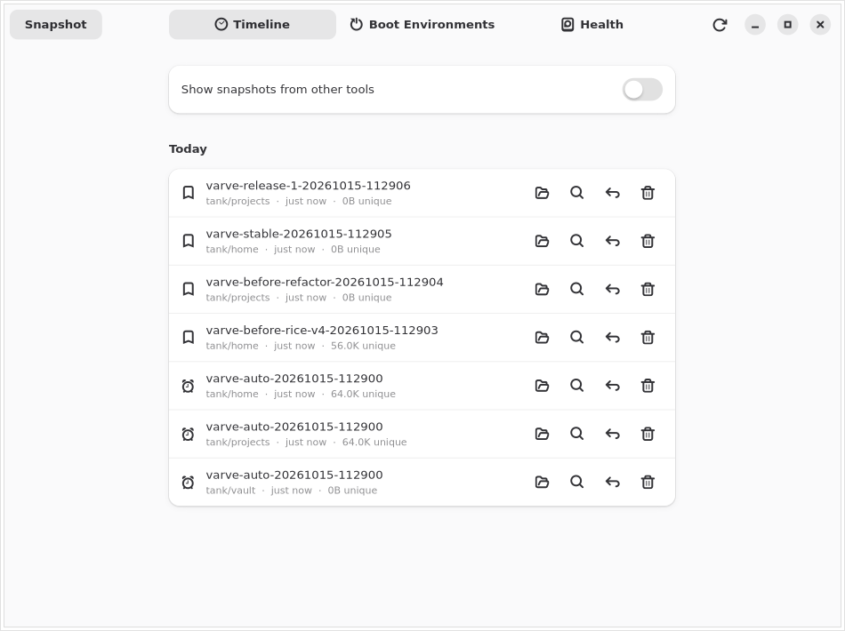

# freebsd-timeline

ZFS snapshots, boot environments and backups for FreeBSD. A root daemon takes
snapshots on a schedule and prunes them by retention rules; a command-line tool
and a GTK4/libadwaita app list, diff, roll back and back them up.



## Features

- **Scheduled snapshots** per dataset, with hourly / daily / weekly / monthly /
  yearly retention. Only freebsd-timeline's own automatic snapshots are ever pruned;
  manual ones and snapshots made by other tools are left alone.
- **Timeline** of every snapshot, grouped by day, with one-click rollback.
- **Browse** any snapshot's files (`.zfs/snapshot`) in your file manager and
  copy back what you need.
- **Diff** a snapshot against now or another snapshot (`zfs diff`).
- **Boot environments** via `bectl`: create, activate (also for one boot
  only), destroy.
- **Guarded upgrades**: `freebsd-timeline guard -- freebsd-update install` makes a boot
  environment first, so a bad upgrade is one reboot away from undone.
- **Backups** to a machine you own: incremental raw `zfs send` over SSH.
  Encrypted datasets arrive still encrypted, so the backup host never sees
  your key.
- **Pool health**: state, space, last scrub, errors.
- **Panic lock**: unmount every encrypted dataset and unload its key with one
  command or button.
- A CLI for everything the GUI does.

## No accounts, no network, no telemetry

freebsd-timeline has nothing to sign up for and nothing to pay for. It never contacts a
server. The daemon listens on a local Unix socket only. The single network
connection it can make is the SSH backup, to a host you configure, using your
own SSH keys. See [SECURITY.md](SECURITY.md) for the threat model.

## How it fits together

```
 freebsd-timeline (CLI)  ──┐
                ├──  /var/run/freebsd-timelined.sock  ──  freebsd-timelined (root)  ──  zfs, zpool, bectl, ssh
 freebsd-timeline-gtk    ──┘      (root + group freebsd-timeline)
```

- `freebsd-timelined` is the only privileged part. It runs the schedule and validates
  every name before it reaches a command line. Commands are executed directly,
  never through a shell.
- `freebsd-timeline` and `freebsd-timeline-gtk` run as your user and talk to the socket. Access is
  controlled by the socket's group (`freebsd-timeline`).

## Install

### FreeBSD

From ports, once it's in the tree:

```sh
pkg install freebsd-timeline        # daemon, CLI and desktop app
```

(Build the port with the `GUI` option off for a headless server.)

From source:

```sh
pkg install rust gtk4 libadwaita
git clone https://github.com/Dishwasher-DEV/freebsd-timeline && cd freebsd-timeline
cargo build --release                 # CLI + daemon
cargo build --release -p freebsd-timeline-gtk    # desktop app
install -m 555 target/release/freebsd-timelined /usr/local/sbin/
install -m 555 target/release/freebsd-timeline target/release/freebsd-timeline-gtk /usr/local/bin/
install -m 555 contrib/freebsd/freebsd-timelined /usr/local/etc/rc.d/
install -m 644 examples/freebsd-timeline.toml /usr/local/etc/freebsd-timeline.toml
```

Then:

```sh
pw groupadd freebsd-timeline -M yourname   # who may use freebsd-timeline without root
sysrc freebsd_timelined_enable=YES
service freebsd-timelined start
freebsd-timeline status
```

### Linux (OpenZFS)

Everything except boot environments works with OpenZFS on Linux. Use
`contrib/linux/freebsd-timelined.service` and put the config in `/etc/freebsd-timeline.toml`.

## Usage

```sh
freebsd-timeline status                              # overview
freebsd-timeline list                                # freebsd-timeline's snapshots (--all for every snapshot)
freebsd-timeline snap zroot/home -l before-rice-v4   # snapshot now, with a label
freebsd-timeline diff zroot/home@freebsd-timeline-manual-...    # what changed since then
freebsd-timeline rollback zroot/home@freebsd-timeline-...       # go back (asks first)
freebsd-timeline be list                             # boot environments
freebsd-timeline guard -- pkg upgrade                # boot environment, then upgrade
freebsd-timeline prune -n                            # what retention would delete
freebsd-timeline backup                              # send to the backup host
freebsd-timeline lock                                # panic lock
freebsd-timeline unlock zroot/home
```

Add `--json` to any command for machine-readable output.

## Configuration

See [examples/freebsd-timeline.toml](examples/freebsd-timeline.toml). The daemon notices edits to
the file by itself; no restart needed. Check a config with
`freebsd-timelined --check-config`.

## Backups

freebsd-timeline sends raw, incremental snapshots to a machine you own over SSH. The
daemon runs as root, so *root's* SSH key and host key setup are what count.

On the backup machine, create a pool or dataset to receive into and let an
ordinary user receive there (no root login needed):

```sh
zfs create tank/backups
zfs allow -u backup receive,create,mount,mountpoint tank/backups
```

On the machine being backed up:

```sh
doas ssh-keygen -t ed25519                       # as root, if it has no key yet
doas cat /root/.ssh/id_ed25519.pub               # add this to backup@host's authorized_keys
doas ssh backup@host true                        # once, to accept the host key
```

Then add to `freebsd-timeline.toml`:

```toml
[backup]
target = "backup@host"
dest = "tank/backups/laptop"
datasets = ["zroot/home"]
auto = true
```

`freebsd-timeline backup` sends the newest freebsd-timeline snapshot of each dataset. The first
send is full, later ones are incremental. If the backup already has history
that shares no snapshot with the source, freebsd-timeline refuses rather than overwrite
it. SSH runs in batch mode, so a missing host key or key login fails with a
clear message instead of hanging on a prompt.

Encrypted datasets are sent raw, so they stay encrypted on the backup machine
and it never receives the key. Unencrypted datasets are stored in the clear
there, so encrypt what you back up.

## Tested on

- FreeBSD 15.1-RELEASE amd64, OpenZFS, `bectl`: snapshots, diff, rollback,
  boot environments, pool health, encryption lock/unlock, and backups (full,
  incremental, up-to-date no-op) against real ZFS using throwaway pools.
- The encryption claim above was checked directly: a raw-sent encrypted
  dataset arrived as `aes-256-gcm` with its key unavailable, and its contents
  did not appear in the backup pool's disk image, while a plain dataset's did.
- Not yet tested: the GUI on FreeBSD, Linux/OpenZFS, multi-disk pools, and
  pools with many thousands of snapshots.

## Development

You don't need ZFS to work on freebsd-timeline. A mock backend fakes a small FreeBSD
laptop:

```sh
cargo test
FREEBSD_TIMELINE_BACKEND=mock FREEBSD_TIMELINE_SOCKET=/tmp/freebsd-timeline.sock cargo run -p freebsd-timelined &
FREEBSD_TIMELINE_SOCKET=/tmp/freebsd-timeline.sock cargo run -p freebsd-timeline-cli -- status
FREEBSD_TIMELINE_SOCKET=/tmp/freebsd-timeline.sock cargo run -p freebsd-timeline-gtk
```

`FREEBSD_TIMELINE_SCREENSHOT=out.png FREEBSD_TIMELINE_PAGE=health freebsd-timeline-gtk` renders the window to
a PNG and exits, which is how the screenshots here are made.

## Roadmap

- Automatic rollback when a freshly upgraded boot environment fails to boot
- Per-file restore from the GUI
- Space breakdown per snapshot, with prune suggestions
- Desktop notifications from the daemon (pool degraded, backup failed)
- Pull-mode backups, so the backup host never needs write access from the laptop

## License

BSD-2-Clause. See [LICENSE](LICENSE).
